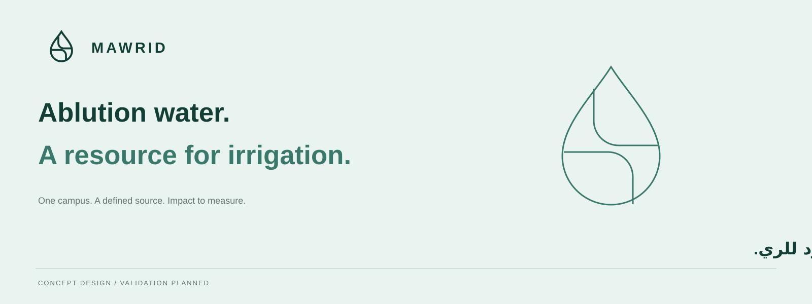

<div align="center" dir="rtl">
  
</div>

# مورد · MAWRID

**مياه الوضوء، مورد للري.**

مورد تصميم لوحدة محلية تسترجع مياه الوضوء المفصولة في منشأة جامعية، وتعالجها لري المساحات الخضراء، وتمنع إعادة الاستخدام عند فشل شروط التشغيل المحددة، وتوثق الماء المستخدم فعلًا.

**الوضع الحالي:** تصميم مفاهيمي وتجربة رقمية تعليمية. لا توجد في المستودع نتائج معالجة مائية فعلية، أو تجربة ميدانية معتمدة، أو شراكة مؤكدة، أو نموذج ذكاء اصطناعي مدرّب. البيانات المعروضة للمحاكاة، ومعايير الأداء أهداف تحتاج اختبارًا.

[مرجع المشروع](docs/project-brief.md) · [المستكشف التعليمي](index.html) · [خريطة المخرجات](docs/judging-map.md) · [سجل الأدلة](docs/evidence-register.md) · [English](#english)

## المشكلة في موقع واحد

نبدأ بموقع جامعي لديه منطقة وضوء مركزية وطلب قريب على الري. السؤال الذي نختبره: هل يمكن استرجاع هذا المصدر واستخدامه محليًا، بتكلفة وعبء تشغيل مقبولين، وبعد إثبات متطلبات استخدامه؟

نقيس كمية الماء ومواقيت توفره والطلب على الري وإمكانية فصل التصريف قبل تحديد حجم الوحدة. إدارة المرافق هي العميل المستهدف، وفريق الصيانة هو المستخدم اليومي. اختيار الموقع والتعاون معه ما زالا خطوة مطلوبة.

## منتج واحد، ووظائف واضحة

| الوظيفة | ما نحتاج إثباته |
|---|---|
| استرجاع المصدر ومعالجته | أداء محدد للماء الداخل، والغرض المختار، وطريقة قياس موثقة |
| حماية مسار إعادة الاستخدام | متحكم مستقل يغلق المسار عند فشل شروط التشغيل أو فقد قياس حرج |
| قياس الاستخدام والتشغيل | موازنة ماء قابلة للمراجعة، وسجل أحداث، ووقت صيانة وتكلفة |

المسار المقترح: **فصل مياه الوضوء، موازنة التدفق، ترشيح، اختبار امتزاز عند الحاجة، تعقيم نتحقق منه، تخزين مضبوط، ثم قرار الاستخدام أو التحويل.**

الري المقترح في البداية هو ري نباتات زينة بالتنقيط في نطاق مضبوط؛ تفاصيله النهائية تحتاج مراجعة الموقع والمخاطر والمتطلبات التنظيمية. مرحلة الاختبار المائي تبدأ على منصة مخبرية قبل أي تطبيق ميداني.

## أين نبحث عن التميز؟

نختبر خرطوشة فحم حيوي من مخلفات النخيل أمام **الترشيح والتعقيم دون امتزاز** و**الكربون المنشط التجاري**. نحدد المكوّن المستهدف بالامتزاز أولًا، ثم نقارن الأداء، وما قد تطلقه المادة إلى الماء، وعمر الخدمة والكلفة. إذا لم تضف الخرطوشة قيمة قابلة للقياس، نستخدم المسار الأبسط.

تبدأ الصيانة بقواعد تشغيل مفهومة. يمكن دراسة التنبؤ والذكاء الاصطناعي لاحقًا إذا توفرت بيانات ممثلة وأثبتت فائدة إضافية. قرار فتح مسار إعادة الاستخدام يبقى لدى المتحكم المستقل، وتحقق جودة الماء يعتمد على الطرق المخبرية والمتطلبات المنطبقة.

## ما الذي يشرحه الموقع؟

[المستكشف التعليمي](index.html) يعرض مكونات التصميم ومسار الماء وسيناريوهات التشغيل. الشكل ثلاثي الأبعاد والمحاكاة يشرحان الفكرة؛ أبعاد المكونات وأداء المعالجة والاستجابة المادية للصمامات تحتاج تحققًا فعليًا. وجود الواجهة في المستودع لا يعني أن نسختها الحالية منشورة أو أن وحدة مائية بُنيت.

المبدأ التشغيلي المستهدف: **عند فقد شروط التشغيل الموثوقة، يُغلق مسار إعادة الاستخدام.**

## طريق الإثبات

1. تحديد موقع وعميل واستخدام واحد، وقياس المصدر والطلب.
2. الاتفاق على بروتوكول ومؤشرات قبول قبل الاختبار.
3. مقارنة المعالجة الأبسط والكربون التجاري وخرطوشة النخيل إن ثبتت الحاجة إليها.
4. اختبار التحكم والموازنة المائية وأعطال الحساسات والطاقة.
5. مراجعة النتائج والتكلفة وعبء المشغل؛ ثم تقرير جدوى تجربة ميدانية بشروطها.

تربط [خريطة المخرجات التسعة](docs/judging-map.md) كل جزء بالدليل الموجود وما ينقصه. وتوضح [خطة التحقق](docs/validation.md) الاختبارات التقنية المقترحة.

## التشغيل المحلي

من مجلد المستودع، باستخدام Node.js 22.12 أو أحدث:

```powershell
npm.cmd ci
npm.cmd run dev
```

افتح [الموقع المحلي](http://127.0.0.1:4173). للتحقق شغّل `npm.cmd run check`، ولتوليد الصفحة الثابتة شغّل `npm.cmd run build`. يشرح [دليل التطوير](docs/development.md) ملفات المصدر ومخرجات `index.html` و`assets/app/`؛ البناء محلي ولا ينشر الموقع.

## الوثائق والمراجع

[مرجع المشروع](docs/project-brief.md) هو المصدر المعتمد للنطاق والعميل والاستخدام والحالة. تبدأ منه الوثائق العامة، وتشرح الوثائق التقنية التفاصيل والفرضيات التجريبية.

| الوثيقة | ما ستجده فيها |
|---|---|
| [خريطة مخرجات المعسكر](docs/judging-map.md) | التسعة مخرجات، حالة كل منها، والدليل المطلوب |
| [سجل الأدلة](docs/evidence-register.md) | الفرق بين التصميم والمحاكاة والهدف والنتيجة |
| [الهوية والمحتوى](docs/brand-and-content.md) | الاسم والصياغة والمصطلحات وطريقة عرض الادعاءات |
| [التصميم المرئي الموحد](docs/visual-design.md) | ترتيب مكونات الوحدة وعلاقة المجسم بصورة الجامعة |
| [مراجع التصميم](docs/design-references.md) | المصادر الرسمية والتقنيات المستخدمة ومنشأ الصور وتراخيص الخطوط |
| [أبحاث النخيل](docs/palm-research.md) | ما تدعمه الدراسات وما يحتاج إثباتًا في مورد |
| [دليل التطوير](docs/development.md) | تشغيل الواجهة واختبارها وبناؤها ومصدر ملفات GitHub Pages |
| [تصميم النظام](docs/system-design.md) | المكونات والأجهزة وحالات التشغيل |
| [الأساس العلمي](docs/scientific-basis.md) | دور المعالجة والامتزاز وحدود القياس |
| [الابتكار والبدائل](docs/innovation.md) | فرضية التميز والمقارنة والأفكار السابقة |
| [التحقق التجريبي](docs/validation.md) | بروتوكول المقارنة والاختبار ومعايير القبول المقترحة |
| [المخاطر والحماية](docs/safety.md) | الحواجز ومسار التحويل والتخزين والفحوص |
| [الأثر والتكلفة](docs/impact-and-economics.md) | الموازنة المائية وتكاليف التركيب والتشغيل |
| [خريطة التطوير](docs/roadmap.md) | بوابات الانتقال من التعريف إلى النموذج والتطبيق |
| [التحكم والتحليلات](docs/ai-and-iot-architecture.md) | الحساسات والبرمجيات وحدود سلطة الذكاء الاصطناعي |
| [بطاقة البيانات والنموذج](docs/data-and-model-card.md) | حالة البيانات والتقييم والقيود |
| [مطابقة الحساسات والمختبر](docs/sensor-and-lab-workflow.md) | المعايرة وتتبع العينات والمقارنة |
| [سيناريوهات المحاكاة](docs/demo-scenarios.md) | السيناريو الطبيعي والتدهور والأعطال |
| [البيانات](data/README.md) | ملفات توضيحية موسومة بالمحاكاة ومخططات البيانات |
| [المراجع](references/README.md) | المصادر العلمية والرسمية؛ ليست نتائج تجارب مورد |

للاستشهاد بالمشروع، راجع [بيانات الاستشهاد](CITATION.cff). لا يتضمن هذا المستودع اعتمادًا لتركيب منظومة أو إعادة استخدام ماء؛ التطبيق يحتاج مراجعة مختصة وتحققًا مخبريًا وموافقات منطبقة.

## English

**MAWRID — Ablution water, a resource for irrigation.**

MAWRID is a concept for a university facility: collect source-separated ablution water, treat it for a defined landscape-irrigation use, protect the outlet with an independent rule-based controller, and record water actually used.

The current repository contains a conceptual design and an educational digital experience. It contains no measured MAWRID treatment results, approved field pilot, confirmed partnership, or trained AI model. Demo inputs are simulated. The 3D view explains components and flow; it does not validate dimensions, treatment performance, or physical valve behaviour.

Date-palm biochar is a testable hypothesis. It must demonstrate value against a simpler treatment train and commercial activated carbon. Maintenance starts with transparent rules; predictive analytics comes later if representative data supports it. Laboratory verification and applicable approvals govern the intended water use.

Start with the [project brief](docs/project-brief.md), [nine-deliverable map](docs/judging-map.md), [evidence register](docs/evidence-register.md), and [technical references](references/README.md). For the digital experience, see the [design sources and asset provenance](docs/design-references.md) and [development guide](docs/development.md).
