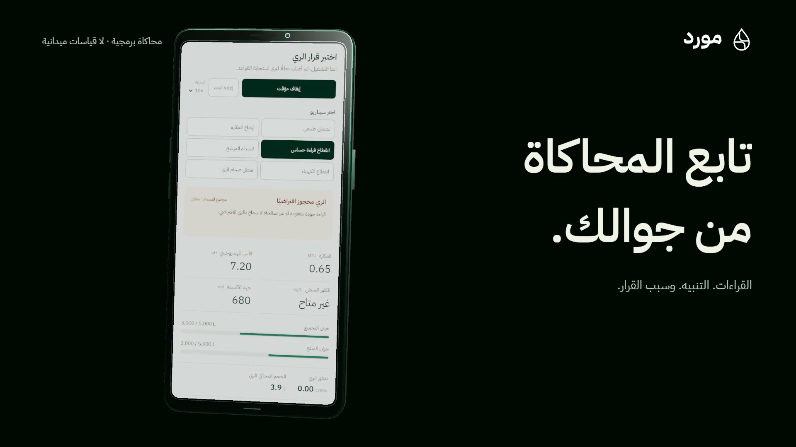

# مورد · MAWRID

**مياه الوضوء، مورد للري. لا لتر بلا تحقق.**

مورد مشروع لإعادة استخدام مياه الوضوء والمغاسل المفصولة في ري مساحات خضراء محددة.
أنجزنا **نموذجًا برمجيًا محليًا يعمل**: محطة افتراضية ثلاثية الأبعاد، ومحاكاة تشغيل، وقواعد قرار، ولوحة متابعة وسجل.
**لم تُبنَ المحطة المادية بعد، ولم تُقَس جودة مياه مورد أو كفاءة معالجتها.**

**[جرّب المحاكاة مباشرة في المتصفح](https://sultalfaifi.com/mawrid-water-reuse/experience/)** · [الموقع التعريفي](https://sultalfaifi.com/mawrid-water-reuse/) · [دليل المحكّم](docs/judge-guide.md)

[](https://sultalfaifi.com/mawrid-water-reuse/assets/demo/mawrid-smart-demo.mp4)

[شاهد مورد — دقيقة واحدة، بلا صوت](https://sultalfaifi.com/mawrid-water-reuse/assets/demo/mawrid-smart-demo.mp4). مجسم النموذج، وقواعد الحماية، ومتابعة المحاكاة من الجوال؛ مع مثال تاريخي موثّق من بحث الذكاء الاصطناعي. البحث مستقل عن المحاكاة، ولم تُنفّذ محطة ميدانية. [مصدر الفيلم وحدوده والنسخ السابقة](video/v3/README.md).

## ما الذي يعمل؟

| الجزء | الموجود وحدوده |
|---|---|
| **تجربة المتصفح** | رحلة المحطة ومشهدها وحالات تشغيل وأعطال؛ محاكاة مستقلة بلا Python أو SQLite أو عتاد أو ML. |
| **النموذج المحلي** | مشهد مرتبط بمحرك المحاكاة، وخزانات وتدفقات وقراءات، وقواعد ري واحتجاز، وتنبيهات وسجل SQLite وتصدير. المعدات والقياسات افتراضية. |
| **بحث البيانات العامة** | تجارب كشف شذوذ على GECCO وWaterHub وإعادة عرض بحثية محدودة في التطبيق المحلي؛ لم يثبت صلاحيتها لحساسات مورد أو تشغيله الميداني. |

ابدأ رحلة الماء، ثم جرّب فقد قراءة حساس وراجع سبب الاحتجاز. جميع قراءات التجربة `SIMULATED`. قواعد التشغيل ثابتة وتجريبية؛ الذكاء لا يمنح صلاحية فتح مخرج الري.

**المواصفات تصميمية:** 1,000 لتر/ساعة؛ أي 15 م³/يوم عند 15 ساعة تشغيل، وخزانان 5 م³، وكربون تجاري وUV اختياري. **ما ينتظر الإثبات:** أداء المعالجة الكيميائي والميكروبي، وربط الحساسات والصمامات، والوفر والتكلفة وشراكة الموقع. نجاح البرمجيات لا يثبت سلامة الماء أو اكتمال المحطة.

## تشغيل النموذج المحلي

يلزم **Python 3.10 أو أحدث**. من جذر المستودع:

```sh
python3 -B mawrid-system/server/main.py
```

على Windows استخدم `py -3 -B mawrid-system/server/main.py`. افتح [127.0.0.1:8787](http://127.0.0.1:8787/#start)، ثم «جرّب المحطة». [دليل النظام](mawrid-system/README.md) يشرح العرض والسجلات والبحث الاختياري. نشر الموقع لا ينشر هذه الخدمة أو قاعدة جهازك.

## الأدلة والتفاصيل

[سجل الأدلة](docs/evidence-register.md) · [مرجع المشروع](docs/project-brief.md) · [خريطة التسليم](docs/judging-map.md) · [خطة التحقق](docs/validation.md) · [بطاقة النموذج ونتائجه](docs/data-and-model-card.md) · [أصول البحث](docs/research-assets.md)

**الأرشيف محفوظ:** [المخرجات والأدلة](output/) و[شيفرة البحث](ml/) و[سجل التغييرات](CHANGELOG.md) باقية بمساراتها ونسخها. لكل تقرير تاريخ ونطاق؛ لا تمثل نتيجة قديمة أحدث حالة، ولا يثبت التدقيق الحسابي جودة النموذج. [دليل المحكّم](docs/judge-guide.md) يربط الادعاءات بأدلتها، و[دليل التطوير](docs/development.md) يشرح البناء والاختبارات والنشر.

**English:** MAWRID has a working local virtual-plant prototype with a linked 3D view, experimental rules and SQLite logs, plus a separate browser simulation. No physical treatment, water-quality performance or field-ready ML is established.

## الترخيص والإسناد

[MIT](LICENSE) للبرمجيات والوثائق مع مراعاة حقوق الغير. تحتفظ خطوط [IBM Plex Sans Arabic](assets/fonts/LICENSE-plex-arabic.txt) و[Manrope](assets/fonts/LICENSE-manrope.txt) بتراخيصها؛ تبقى حقوق البيانات والمكتبات والمنشورات والشعارات لأصحابها، والاستشهاد لا يعني شراكة.

المشاهد مفاهيم غير منفذة: [منشأ الأصول](docs/design-references.md) · [المراجع](references/README.md) · [الإسناد العلمي](CITATION.cff) · [المساهمة](CONTRIBUTING.md). تبقى المرفقات الخاصة وقواعد بيانات التشغيل المحلية وبيانات الاتصال خارج المستودع العام.
