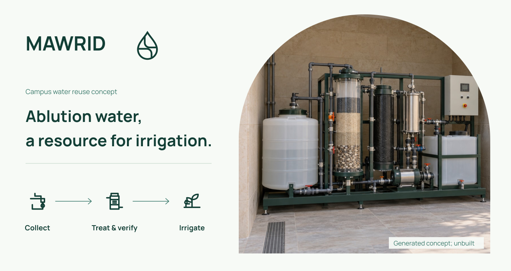

# MAWRID

**Ablution water, a resource for irrigation.**

A campus water-reuse concept connecting one source to one nearby use: collect source-separated ablution water, treat it for landscape irrigation, protect the outlet with an independent controller, and measure water actually used.

[Project website](https://sultalfaifi.com/mawrid-water-reuse/) · [Brand guide](https://sultalfaifi.com/mawrid-water-reuse/assets/brand/guide/index.html) · [Project brief](docs/project-brief.md) · [Evidence register](docs/evidence-register.md)

## One source. One use. One first customer.

| Scope | First version |
|---|---|
| Source | Ablution water collected through a separate drain; toilets, kitchens and mixed wastewater are excluded. |
| Use | Landscape irrigation, initially ornamental planting with drip irrigation in a defined area. |
| Setting | One university facility with a central ablution area and nearby irrigation demand. |
| Customer | University facilities management; maintenance staff operate the proposed unit. |
| Value to establish | Water actually used, operating cost and maintenance effort at the selected site. |

Source volume, demand, site suitability and customer interest require confirmation. Drinking water, reuse for ablution and food preparation are outside this scope.

## The proposed water journey

**Separate and collect → balance and filter → test adsorption if needed → disinfect and store → verify conditions → irrigate or divert.**

Date-palm-derived media is an optional adsorption trial, included only for a defined treatment need and a fair comparison with alternatives.

The proposed independent controller closes the reuse path and diverts water if an operating condition fails or a critical measurement is lost. Sensors monitor the process; laboratory methods verify water for its intended use. Analytics support maintenance, without authority to open the outlet.

[System design](docs/system-design.md) · [Treatment diagram](assets/diagrams/treatment-train.svg) · [Outlet protection and risks](docs/safety.md)

## What exists today

| Area | Repository status |
|---|---|
| Digital experience | Interactive 3D unit, campus carousel, research links and simulated operating scenarios. |
| Water treatment | Conceptual hardware and a validation plan. No measured MAWRID treatment results. |
| Outlet protection | Software rules tested with synthetic inputs. Physical controller, valve and power-failure tests remain. |
| Date-palm media | Adsorption hypothesis. Performance, service life, material release and cost remain unproven. |
| Data and AI | Illustrative telemetry and schemas. No field dataset or trained MAWRID AI model. |
| Field adoption | Target customer and use case. No confirmed partnership, approved field pilot or certification documented. |

The website is an educational digital prototype. Its geometry and generated scenes explain the concept; dimensions, water quality and physical hardware require validation. Performance and cost figures in the plan are targets or examples, without guarantees.

## Where the design aims to add value

- **A defined source and nearby use.** Size against measured source flows and irrigation demand.
- **An optional local medium.** Compare palm biochar with treatment without adsorption and commercial activated carbon. Keep the simpler route if it adds no measurable value.
- **An independent outlet decision.** Test sensor, valve and power faults before a field trial.
- **A traceable water balance.** Account for actual irrigation use, diversion, washing, makeup water, energy and maintenance. Separate recovered use from net potable-water offset.

These are design priorities and hypotheses. Studies support mechanisms or methods; they do not establish MAWRID results, partnerships or superiority.

[Innovation and alternatives](docs/innovation.md) · [Palm-media research](docs/palm-research.md) · [Scientific references](references/README.md)

## The evidence path

1. Confirm the site, customer and use; measure source and demand.
2. Define methods, controls and acceptance criteria before testing.
3. Compare treatments in the laboratory, with adsorption where justified.
4. Test physical outlet protection and faults; reconcile the water balance.
5. Review results, cost, workload and applicable requirements before a bounded field trial.

The [evidence register](docs/evidence-register.md) distinguishes design, simulation, literature, targets and results. Follow the [validation plan](docs/validation.md) and [roadmap](docs/roadmap.md) for proposed experiments and evidence gates.

## Nine deliverables, one project story

The [camp deliverable map](docs/judging-map.md) records evidence and gaps for each required output, without implying completion, submission or a judging score.

| # | Required output | Starting document |
|---|---|---|
| 1 | Team information, roles and capacity | [Deliverable map](docs/judging-map.md) |
| 2 | Problem and need for a solution | [Project brief](docs/project-brief.md) |
| 3 | Solution and level of innovation | [System design](docs/system-design.md) / [Alternatives](docs/innovation.md) |
| 4 | Customer and value | [Project brief](docs/project-brief.md) |
| 5 | Prototype plan and success criteria | [Validation plan](docs/validation.md) |
| 6 | Prototype diagram and components | [Treatment diagram](assets/diagrams/treatment-train.svg) / [Visual design](docs/visual-design.md) |
| 7 | Implementation plan and resource needs | [Roadmap](docs/roadmap.md) |
| 8 | Feasibility, scaling and impact | [Impact and economics](docs/impact-and-economics.md) |
| 9 | One-page project summary | [Project brief](docs/project-brief.md) |

Team contacts and private approvals belong in the private submission pack.

## Explore the project

The [project website](https://sultalfaifi.com/mawrid-water-reuse/) connects the unit, palm-material hypothesis and simulator. Campus scenes follow **ablution → unit → laboratory check → irrigation → maintenance**.

The website supports Arabic and English. The detailed project documents are currently primarily in Arabic; this README provides an English entry point.

| Reference | Purpose |
|---|---|
| [Project brief](docs/project-brief.md) | Authoritative scope, customer, current status and boundaries. |
| [Sensor and laboratory workflow](docs/sensor-and-lab-workflow.md) / [Control architecture](docs/ai-and-iot-architecture.md) | Calibration, sample tracking and control authority. |
| [Data and model card](docs/data-and-model-card.md) / [Example data](data/README.md) / [Demo scenarios](docs/demo-scenarios.md) | Data status, simulated records and fault scenarios. |
| [Design sources and asset provenance](docs/design-references.md) | Visual references, generated-image provenance and font licenses. |
| [Development guide](docs/development.md) | Source structure, interaction behavior and static-site build outputs. |

## Identity and visual direction

The website's line-drawn drop mark anchors **forest green, pale paper, mint and warm limestone**, with IBM Plex Sans Arabic and Manrope typography. The visual world is a bright Saudi campus: restrained Islamic geometric screens, palms and natural morning light.

The [23-page guide](https://sultalfaifi.com/mawrid-water-reuse/assets/brand/guide/index.html) covers logos, clear space, colors, typography, patterns, icons, imagery, motion and applications.

[Brand-book PDF](output/pdf/mawrid-brand-book.pdf) · [Full identity kit](https://github.com/SultanAlfaifi/mawrid-water-reuse/releases/download/identity-v1.0/mawrid-identity-kit.zip) · [Editable presentation](assets/brand/templates/mawrid-presentation.pptx) · [Brand assets and reproduction instructions](assets/brand/README.md)

Generated scenes are labeled as unbuilt concepts. Institutional logos identify cited research sources, with a link to the relevant study.

## Getting started

Requires **Node.js 22.12 or newer** and npm. From the repository root:

```sh
npm ci
npm run dev
```

Open [http://127.0.0.1:4173](http://127.0.0.1:4173). On Windows PowerShell, use `npm.cmd` if required.

```sh
npm run check
npm run build
```

`check` tests digital decision rules. `build` generates `index.html` and `assets/app/` from `web/`; it does not publish or validate water treatment. Also check interactions, both languages, mobile layouts, reduced motion and WebGL fallback in a browser.

| Path | Role |
|---|---|
| `web/` | Editable website source. |
| `docs/`, `data/`, `references/` | Project definition, evidence, examples and sources. |
| `assets/brand/`, `assets/images/`, `assets/diagrams/` | Identity system, concept imagery and explanatory diagrams. |
| `scripts/brand/` | Reproducible identity and document generators. |
| `tests/` | Software decision-rule tests. |
| `index.html`, `assets/app/` | Generated static website outputs. |

Built with **Vite, Three.js, GSAP, Marked and DOMPurify**, locally hosted fonts and locked dependencies. See the [development guide](docs/development.md) and the separate [identity-generation toolchain](assets/brand/README.md).

## Licensing and attribution

See the [MIT license](LICENSE) for software and project documentation. Fonts retain their SIL Open Font License notices: [IBM Plex Sans Arabic](assets/fonts/LICENSE-plex-arabic.txt) and [Manrope](assets/fonts/LICENSE-manrope.txt). Third-party logos and publications retain their rights; citation does not grant reproduction rights.

Image-generation prompts and provenance are recorded in the [design references](docs/design-references.md). Use [CITATION.cff](CITATION.cff) when citing the project.
