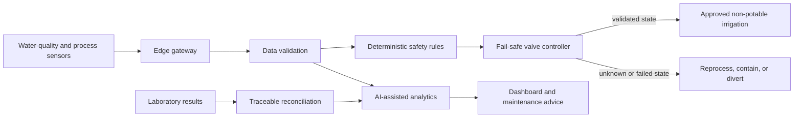

# AI and IoT Architecture

> **Status:** Proposed architecture. The deterministic state machine can be prototyped before a predictive model is trained. No AI performance result is claimed.

The [Rabigh proposal](rabigh-plan.md) covers a complete treatment/monitoring unit and a retrofit MAWRID Smart Box for compatible existing plants. Target customers include Haramain facilities and large complexes; the proposed first bench test is at the Energy and Water Academy, subject to permission. The public website's simulated telemetry, control state and 3D flow are separate from a field gateway, physical actuator and laboratory record. A realistic rendering does not establish built hardware or treatment validation.

## Design principle

MAWRID separates decision support from safety authority:

> AI predicts and explains. Validated rules protect the reuse outlet.

The architecture must remain safe if the model, network, dashboard, cloud service, or a non-critical sensor fails.

## Functional architecture

## Edge layer

The proposed bench separates an **ESP32 safety controller** from a **Raspberry Pi 5** for local records, interface and research, with a UPS and normally closed irrigation valve. This is an unbuilt hardware proposal; the current Python/SQLite service runs on a host computer. Field hardware selection needs a hazard and reliability review. Retrofit compatibility must be surveyed rather than assumed for every existing plant.

Independent connectivity, fleet dashboards and remote reporting are intended capabilities, not deployed services. Separate connectivity does not establish cybersecurity; authentication, encryption, authorization, command expiry and a local safe-state policy remain required. A future user or research-model stop request may restrict operation, but cannot bypass fixed rules or reopen an unsafe outlet.

The edge layer should:

- timestamp and validate every reading;
- reject impossible, stale, or malformed values;
- calculate differential pressure and cumulative bed volumes;
- retain a local event buffer during network loss;
- execute the safety state machine locally;
- drive the diversion valve without depending on cloud connectivity.

## Data layer

Every observation should carry a sensor identifier, unit, timestamp, calibration status, quality flag, and evidence label. Laboratory records must preserve sample identity, collection time, method, result, unit, detection limit, and quality-control status.

The initial implementation can use CSV or a small local database. A pilot may use MQTT for telemetry and a time-series database, subject to cybersecurity and data-governance review.

The sample CSV uses a simulated gateway identifier and simulated calibration and quality flags. These fields demonstrate the data contract; they are not calibration certificates. A stale, missing, or invalid critical reading must produce a non-reuse state rather than be converted to zero or replaced silently with the last value.

Browser alerts should expose the relevant reading, threshold, timestamp, rule version, and reason for the state transition. Keep control buttons and evidence labels in accessible HTML as well as any 3D scene. The public website does not command a real reuse valve.

## Analytics layer

### Transparent baseline

The first release should use auditable rules:

- rising differential pressure with falling flow suggests hydraulic clogging;
- rising outlet turbidity suggests loss of filtration integrity;
- a flat-lined or implausibly discontinuous signal suggests a sensor fault;
- repeated sensor-to-laboratory disagreement suggests possible drift;
- missing critical data forces a non-reuse state.

### Candidate AI functions

1. **Anomaly detection:** identify multivariable patterns that differ from validated normal operation.
2. **Filter-health estimation:** combine hydraulic loading, differential pressure, flow, and treatment indicators into an explainable condition estimate.
3. **Maintenance forecasting:** estimate a maintenance window only after multiple representative filter-life datasets are available.

Models must be compared with the transparent baseline. A more complex model advances only if it improves prospective performance without weakening safety or interpretability.

## Safety boundary

AI outputs are advisory. They may trigger inspection, sampling, cleaning, or maintenance recommendations. They must not:

- certify microbial or chemical safety;
- override a failed release criterion;
- open the reuse valve;
- silently change a sensor calibration;
- infer a safe state from the last valid reading.

## Cybersecurity and resilience

- Keep safety control local and independent of the public internet.
- Authenticate devices and restrict configuration changes.
- Encrypt remote communications where deployed.
- Log model versions, configuration changes, overrides, and alarms.
- Define safe behaviour for power, network, storage, and clock failures.
- Require human authorization for calibration changes and model deployment.

## Minimum hackathon implementation

- One edge gateway or a faithful hardware emulator.
- Flow, turbidity, and differential-pressure inputs.
- A local safety state machine connected to a visible valve or relay.
- A dashboard that shows current state, evidence label, alarms, and explanations.
- Reproducible normal, degradation, sensor-loss, and high-turbidity scenarios.
- Simulated data clearly labeled `SIMULATED`, with no claim of measured treatment performance.
